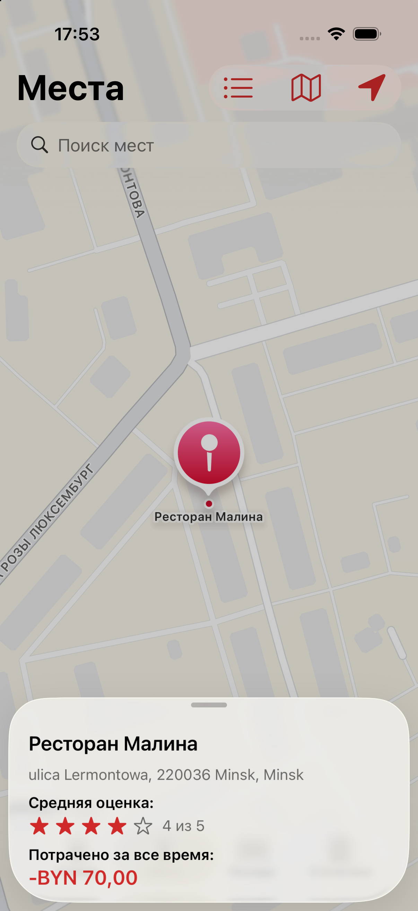
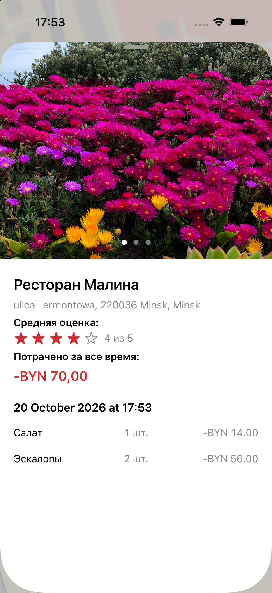
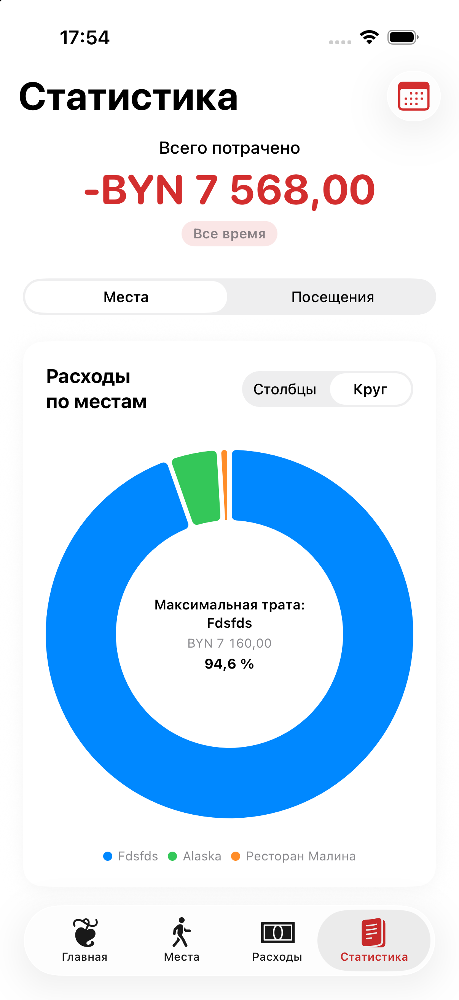
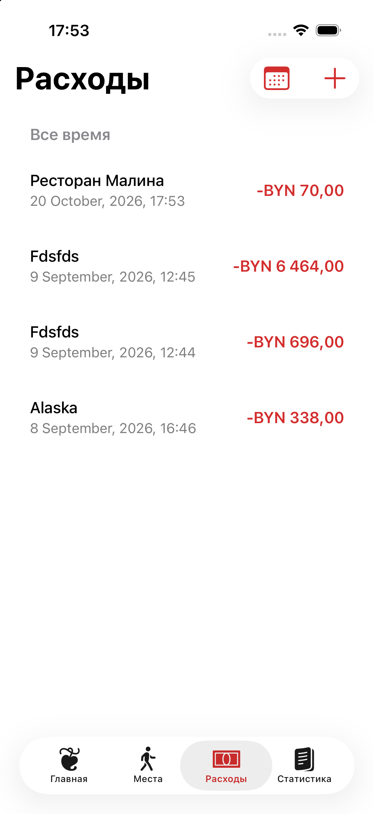
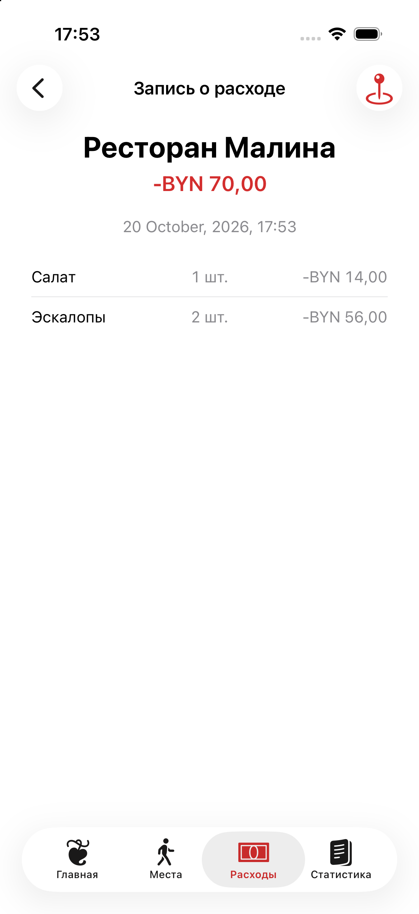

# coinApp

**coinApp** is a native iOS application for keeping track of personal expenses by place. It lets users record visits, attach photos and expense items, rate experiences, explore saved places on a map, and review spending statistics over time.

[GitHub profile](https://github.com/m1tzk) · [Repository](https://github.com/m1tzk/coin)

## Screenshots


| Main screen | Places map | Place details |
|---|---|---|
|  |  |  |

| Finance statistics | Expense records | Expense details |
|---|---|---|
|  |  |  |

<div align="center">
  <table>
    <tr>
      <th align="center">Add expense (part 1)</th>
      <th align="center">Add expense (part 2)</th>
    </tr>
    <tr>
      <td align="center">
        
      </td>
      <td align="center">
        
      </td>
    </tr>
  </table>
</div>

## Features

### Expense tracking
- Create expense records associated with a place and a visit date.
- Add individual items or services to a record, specifying a name, quantity, and unit price.
- Calculate item totals and the total amount spent.
- Browse expense records and filter them by time period.
- View details of a record and its associated items.

### Places and map
- Save places with geographic coordinates.
- Display saved places as markers on an interactive map.
- Switch between standard and satellite map styles.
- Request the current location and move the map to it.
- Search places and open a list of saved locations.
- View place details, including its address, visits, photos, rating, and total spending.
- Review visits associated with a place, ordered from newest to oldest.

### Photos and ratings
- Attach photos to expense records/visits.
- Browse photos in a gallery and open them in a larger viewer.
- Set and display a rating for a visit.
- See an average rating for a place when ratings are available.

### Statistics
- Filter statistics by a time period.
- Review total spending for the selected period.
- Compare spending by place using bar or doughnut charts.
- Explore spending over time with bar or line-style visualizations.
- Interact with chart selections to inspect the displayed data.

### Home screen and navigation
- Use a home screen with recent places and shortcuts to key sections.
- Navigate between **Home**, **Places**, **Expenses**, and **Statistics**.
- Open a place or expense record from related screens using shared app navigation state.

## Built with

- **Swift**
- **SwiftUI** — declarative user interface and navigation.
- **SwiftData** — local persistence for places, expense records, expense items, and photos.
- **MapKit** — interactive map, markers, and map styles.
- **Core Location** — access to the device's current location and geographic coordinates.
- **PhotosUI** — selecting photos from the photo library.
- **Charts** — visualizing spending statistics.
- **Observation** — observable shared navigation state.

## Architecture and data model

The app is organized around SwiftUI views and SwiftData models. The `coinApp` entry point creates a model container for the core expense entities, while `CoinView` sets up the tab-based interface and provides a shared `AppRouter` through the environment.

The main persisted entities include:

- `Place` — a saved location with coordinates and related visits.
- `ExpenseRecord` — a visit/expense record, including date, currency, rating, items, and photos.
- `ExpenseItem` — an individual service or purchase with quantity and unit price.
- `ExpensePhoto` — photo data and its ordering within a record.

Relationships connect places to their visits and records to their items and photos. The item and photo relationships use cascade deletion so related data is removed with its parent record.

## Project structure

The exact Xcode project may contain additional assets and support files. The key source components include:

```text
coinApp/
├── coinApp.swift                 # App entry point and SwiftData container
├── CoinView.swift                # Main tab navigation
├── MainPageView.swift            # Home screen
├── AddExpenseView.swift          # Expense creation
├── BriefFinanceRecordView.swift  # Expense list
├── ExpenseRecordDetailView.swift # Expense record details
├── FinanceStatisticsView.swift   # Charts and spending summaries
├── PlacesOnMapView.swift         # Map with saved places
├── PlaceListView.swift           # Searchable places list
├── PlaceDetailSheet.swift        # Place information and visit history
├── PlacePickerView.swift         # Select a location
├── AppRouter.swift               # Shared navigation state
└── Models/
    ├── Place.swift
    ├── ExpenseRecord.swift
    ├── ExpenseItem.swift
    └── ExpensePhoto.swift
```

*This is a conceptual overview of the main components, not a guaranteed one-to-one representation of the repository's physical folder layout.*

## Requirements

- A Mac with Xcode installed.
- An iOS Simulator or a compatible iPhone.
- A version of Xcode/iOS that supports the SwiftUI, SwiftData, MapKit, and Charts APIs used by the project.

## Getting started

1. Clone the repository:

   ```bash
   git clone https://github.com/m1tzk/coin.git
   cd coin
   ```

2. Open `coinApp.xcodeproj` in Xcode.
3. Select the `coinApp` scheme.
4. Choose an iOS Simulator or a connected iPhone as the run destination.
5. Build and run the app.

The app uses SwiftData for local storage. Map and location functionality may require location permission on a physical device or simulator. If the app requests access to the current location, grant permission to use that feature.

## Author

Created by [m1tzk](https://github.com/m1tzk).

